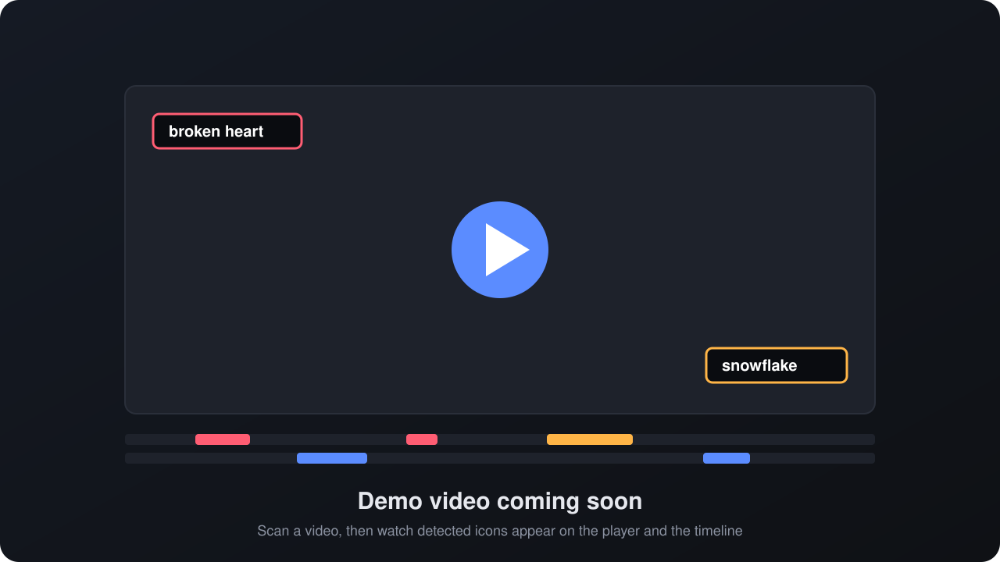

<p align="center">
  
</p>

<h1 align="center">Video Icon Detector</h1>

<p align="center">
  Find every icon, emoji, sticker and logo in a video, with the exact time it appears.<br>
  Powered by Google Gemini, with a web player that shows each detection as the video plays.
</p>

<p align="center">
  <a href="https://github.com/<your-username>/video-icon-detector/actions/workflows/tests.yml">/video-icon-detector/actions/workflows/tests.yml/badge.svg" alt="Tests"></a>
  
  
  
  
  
  
</p>

<p align="center">
  <a href="#demo">Demo</a> ·
  <a href="#overview">Overview</a> ·
  <a href="#features">Features</a> ·
  <a href="#quick-start">Quick start</a> ·
  <a href="#api">API</a> ·
  <a href="#configuration">Configuration</a>
</p>

## Demo

<!--
  Replace this placeholder with a recording of the app:
  1. Record a short screen capture (MP4, under 10 MB works best).
  2. Open any issue or pull request on GitHub and drag the file into the comment box.
  3. Copy the generated https://github.com/user-attachments/... link and paste it here on its own line.
     GitHub renders it as an inline video player.
-->
<p align="center">
  
</p>

## Overview

Edited videos are full of small graphic elements: reaction emojis, stickers, arrows, brand logos, "like" and "subscribe" buttons. Finding all of them by hand means watching the video frame by frame and writing down timestamps, which is slow and easy to get wrong.

Video Icon Detector does this for you. You pick a video and the part you want to check, and the app watches it using Google Gemini. A minute or so later you get a complete list of every icon it found: what it is, what it looks like, where it sits on screen, and exactly when it appears and disappears.

The results are shown directly on the video. Press play and each icon is labelled on screen while it is visible. A timeline under the player gives every icon its own row, so you can see at a glance how often something appears and jump straight to any moment. Everything is also saved as a report you can download and share.

**Who it is for**

- **Video editors and creators** who want to review the overlays and effects in a finished edit.
- **Marketing and sponsorship teams** who need proof of when and how long a brand logo was on screen.
- **Compliance and moderation reviewers** checking content for specific symbols before publishing.
- **Product and UX researchers** who want to know which interface icons appear in screen recordings.

**What a typical session looks like**

1. Open the app and choose a video from your library.
2. Select the part to scan, for example the first minute, and click **Scan for icons**.
3. Follow the progress while the clip is prepared, uploaded and analysed.
4. Play the video and watch the detections appear, or browse the full list of sightings.
5. Download the report as JSON or Markdown, or clear the results and scan again with different settings.

## Features

<table>
  <tr>
    <td width="33%" valign="top">
      <br>
      <b>Icon, emoji and logo detection</b><br>
      Finds graphic overlays, stickers, symbols, brand logos and UI icons, and ignores ordinary objects filmed by the camera.
    </td>
    <td width="33%" valign="top">
      <br>
      <b>Exact timestamps</b><br>
      Every appearance gets a start and end time that matches the original video, even when only part of it is scanned.
    </td>
    <td width="33%" valign="top">
      <br>
      <b>Live overlay player</b><br>
      Detections are labelled on the video while it plays, with a per-icon timeline you can click to jump to any sighting.
    </td>
  </tr>
  <tr>
    <td width="33%" valign="top">
      <br>
      <b>Video library</b><br>
      Browse every video in your folder with thumbnails, durations and scan history, and open any of them in one click.
    </td>
    <td width="33%" valign="top">
      <br>
      <b>Shareable reports</b><br>
      Each scan produces a JSON report for other tools and a Markdown summary that reads well in GitHub, Notion or email.
    </td>
    <td width="33%" valign="top">
      <br>
      <b>Built to keep going</b><br>
      Scans run in the background, switch to a backup model when Gemini is busy, and retry automatically on temporary errors.
    </td>
  </tr>
</table>

## How it works

1. The selected range of the video is cut with FFmpeg and scaled down to 720p, so only a small clip is uploaded.
2. Gemini watches the clip at the chosen frame rate and returns every icon it sees as structured JSON.
3. Timestamps are checked against the clip length, shifted back to match the full video, and saved as a JSON and Markdown report.

```
browser ── FastAPI ── Redis ── Celery worker ── FFmpeg
                                    └────────── Gemini API
```

If the primary Gemini model is overloaded or rate limited, the request moves to the next model in the fallback list. If every model is busy, the job is retried with exponential backoff.

## Quick start

### Requirements

- Python 3.11 or newer
- [FFmpeg](https://ffmpeg.org/download.html) on your `PATH`
- Redis (a `docker-compose.yml` is included)
- A Gemini API key from [Google AI Studio](https://aistudio.google.com/apikey)

### Install

```bash
git clone https://github.com/<your-username>/video-icon-detector.git
cd video-icon-detector

python -m venv .venv
source .venv/bin/activate        # Windows: .venv\Scripts\activate
pip install -r requirements.txt

cp .env.example .env             # then set GEMINI_API_KEY
docker compose up -d             # starts Redis on port 6379
mkdir videos                     # put the videos you want to analyze here
```

### Run

Start the worker and the API in two terminals:

```bash
celery -A app.worker worker --loglevel=info
uvicorn app.api:app --reload
```

Open http://127.0.0.1:8000. The home page lists every video in the `videos/` folder with a thumbnail, its length and how many times it has been scanned. Pick one to open the player.

In the player, choose a start time and length and click **Scan for icons**. When the scan finishes, play the video: detected icons are labelled on screen while they are visible, and the timeline shows one row per icon. **Clear results** deletes the saved reports for that video so you can scan it again from scratch.

Supported formats: MP4, MOV, M4V, WebM, MKV and AVI. MKV and AVI can be scanned, but most browsers cannot play them in the player.

Interactive API docs are available at http://127.0.0.1:8000/docs.

### Command line

For a one-off scan without Redis or a worker:

```bash
python -m app.cli "my video.mp4" --start 0 --length 60
```

## API

| Method | Path | Description |
|---|---|---|
| `GET` | `/api/videos` | Videos in the videos folder, with scan counts |
| `GET` | `/api/videos/{name}/stream` | Stream a video (supports range requests) |
| `GET` | `/api/videos/{name}/thumbnail` | JPEG thumbnail |
| `POST` | `/api/scans` | Start a scan. Body: `video`, `start` and `length` in seconds, `fps` (default 1, max 5) |
| `GET` | `/api/tasks/{task_id}` | Job status, progress stage, result or error |
| `GET` | `/api/reports?video={name}` | Saved reports, newest first, optionally for one video |
| `GET` | `/api/reports/{job_id}?format=json\|md` | Download a report |
| `DELETE` | `/api/reports?video={name}` | Delete every report for a video |
| `DELETE` | `/api/reports/{job_id}` | Delete one report |
| `POST` | `/api/frames` | Ask a question about the frame at a `timestamp` of a `video` |

Example:

```bash
curl -X POST http://127.0.0.1:8000/api/scans \
  -H "Content-Type: application/json" \
  -d '{"video": "my video.mp4", "start": 0, "length": 60, "fps": 1}'
```

## Report format

Each sighting in a report looks like this:

```json
{
  "icon": "broken heart",
  "category": "emoji",
  "description": "Red broken heart next to the speaker, used as a reaction",
  "position": "left",
  "start": "0:18",
  "end": "0:24",
  "start_seconds": 18.0,
  "end_seconds": 24.0
}
```

The report also includes a per-icon summary (appearance count, time on screen, timestamps), the scanned range, and the model that produced it. Reports are written to `reports/` as JSON and Markdown.

## Configuration

All settings are read from environment variables or `.env`.

| Variable | Default | Description |
|---|---|---|
| `GEMINI_API_KEY` | required | Gemini API key |
| `VIDEOS_DIR` | `videos` | Folder with the videos to analyze, absolute or relative to the project root |
| `REPORTS_DIR` | `reports` | Where reports are saved |
| `REDIS_URL` | `redis://localhost:6379/0` | Celery broker and result backend |
| `GEMINI_MODEL` | `gemini-3.8-flash` | Primary model |
| `GEMINI_FALLBACK_MODELS` | `["gemini-3.7-flash", "gemini-3.5-flash", "gemini-2.5-flash"]` | Tried in order when the primary model is busy |

## Tests

```bash
pip install -r requirements-dev.txt
pytest
```

The tests run offline: they do not call Gemini and do not need Redis or FFmpeg. GitHub Actions runs them on Python 3.11, 3.12 and 3.13 for every push and pull request.

## Limitations

- Positions are coarse ("top-left", "center"), so on-screen labels mark the area of an icon rather than a precise bounding box.
- At 1 fps, icons shown for less than a second can be missed. Use 2 to 4 fps for fast-paced edits, at a higher token cost.
- Videos are read from a local folder; there is no upload from the browser yet.

## Project structure

```
app/
  api.py        FastAPI routes
  worker.py     Celery tasks and retry policy
  scanner.py    Cut, detect and report pipeline
  library.py    Video folder listing, thumbnails and safe name lookup
  gemini.py     Gemini client, prompt and model fallback
  video.py      FFmpeg helpers
  report.py     Report building, Markdown export and cleanup
  cli.py        Command-line scan
  static/       Video library and player pages
docs/assets/    Logo, icons and demo placeholder used in this README
tests/
```

## Contributing

Issues and pull requests are welcome. Please run `pytest` before opening a pull request and include tests for new behaviour.
